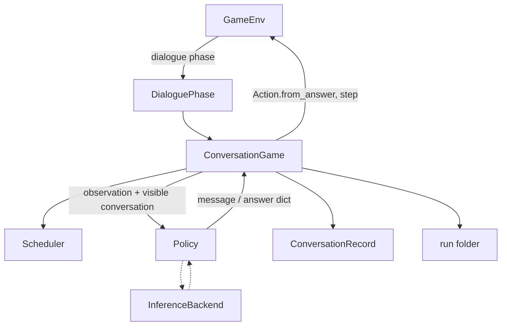

# SelfPlayWorlds

Common environments and infrastructure for multi-agent LLM self-play in strategic social games.

## Start here

- [`docs/design-overview.md`](docs/design-overview.md) — project motivation, design, and current implementation
- [`docs/repo-walkthrough.md`](docs/repo-walkthrough.md) — exact code path and file locations
- [`docs/architecture.md`](docs/architecture.md) — detailed runtime design
- [`docs/progress.md`](docs/progress.md) — current validation status

> One real game (Coup) works end-to-end. The environment exposes the current dialogue phase, and `ConversationGame` supports single actions, response windows, discussion, and simultaneous actions. Coup is the first implementation because it tests more than a simple alternating-turn loop.

## Motivation

Games differ not only in their rules, but in **interaction structure**: who may act, and when.

| Pattern | Example |
|---|---|
| Single action | a player takes their turn |
| Reaction or challenge window | "Does anyone challenge Alice's Duke?" The first challenger closes the window |
| Open discussion | investigators argue about who the murderer is |
| Simultaneous actions | everyone votes or loads a bag without seeing the others |

A framework built around one `current_player` and an alternating loop cannot express the last three. Here, every decision point is an explicit `DialoguePhase` with a mode, a game-specific phase, the players who may act, and how much talk comes first.

## Core design



- **GameEnv** is the source of truth for settings (`game_config`, seed included), rules, hidden state, legality and observations. It never sees talk or calls a model. `get_state()` always reports `done` and `rewards`. It pickles itself and refuses to load a save made with a different config.
- **DialoguePhase** says what is happening now: `phase` (game rule), `mode` (`ACTION`, `RESPONSE_WINDOW`, `DISCUSSION`, `SIMULTANEOUS`), who **may** act, and how many talk rounds come first.
- **ConversationGame** runs each phase: talk, answers, building the game's `Action` from each answer, retries with the reason, fallbacks. It keeps the **ConversationRecord** and saves or loads a whole game. It contains no game rules.
- **Scheduler** decides who is **asked first**. The default is the environment's order.
- **Policy** sees only its own observation and the conversation it may see. **ScriptedPolicy** plays seeded rules; **Player** asks a model and parses `<thinking>` and `<answer>`. Policies save themselves; a Player is saved without its model.

Details: [`docs/architecture.md`](docs/architecture.md).

## Current status

**WORKING NOW**
- Coup end-to-end, 2 to 6 players, rules checked against two rulebook transcriptions ([`docs/coup-rules.md`](docs/coup-rules.md))
- `ACTION` and `RESPONSE_WINDOW` phases, with table talk before decisions
- Scripted, random and LLM (`Player`) policies; the LLM path is tested offline with a mock model
- One run folder per game (settings, environment, conversation record, policies), saved after every step; exact resume
- 164 tests, no model, API key or GPU needed (one is skipped without the optional `llm` extra)

**TEST-SUPPORTED** (proven with a test fixture, no real game yet)
- `DISCUSSION`
- `SIMULTANEOUS`

**DESIGNED / FUTURE**
- Sheriff of Nottingham, Deception, Pit, communication games ([`docs/game-format-matrix.md`](docs/game-format-matrix.md))
- RL integration (for example prime-rl) ([`docs/roadmap.md`](docs/roadmap.md))

### Real-model validation

On CARC, commit `9dcc33f` (before the GameEnv / Policy / ConversationGame redesign) completed one full three-player Coup episode with `Qwen/Qwen2.5-7B-Instruct` served by vLLM on one A40, with 0 invalid outputs. That run used the earlier `{"message", "action"}` prompt. The current `Player` prompt (`<thinking>` / `<answer>`) has not been run against a real model yet.

## Quick start

Needs [uv](https://docs.astral.sh/uv/) and Python 3.11+.

```bash
uv sync
uv run pytest
uv run python examples/run_coup.py
```

Options: `--seed N`, `--players 2..6`, `--quiet`, `--policies scripted|random|llm`, `--out FOLDER`, `--resume FOLDER`.

Example trace (seed 0, the default):

```text
Turn 1: Carol (2 coins)
    Carol claims the Duke and takes Tax.
  [challenge_action] response window: Alice, Bob may respond
    Alice passes.
    Bob challenges Carol's claim to be the Duke.
    Carol reveals the Duke, shuffles it back and draws a new card. Bob loses the challenge.
    Bob loses an influence (lost a challenge) and reveals the Contessa.
    Carol now has 5 coins.

Turn 2: Alice (2 coins)
    Alice claims the Captain and tries to steal from Carol.
  ...
Result: Carol wins after 14 turns (seed 0).
Decisions asked: 33, forced moves applied automatically: 3, invalid answers: 0.
Saved game: runs/coup-seed0-3p
```

[`examples/output/coup-seed0-3p.json`](examples/output/coup-seed0-3p.json) is a legacy episode file from before the redesign. New runs write a run folder instead.

### LLM players (optional)

```bash
uv run python examples/run_coup.py --policies llm --backend mock            # whole LLM path, offline
export OPENROUTER_API_KEY=...                                               # never commit keys
uv run --extra llm python examples/run_coup.py --policies llm --backend openrouter --model <model-id>
uv run --extra llm python examples/run_coup.py --policies llm --backend vllm --model <served-model>   # VLLM_BASE_URL
uv run --extra llm python examples/run_coup.py --resume runs/coup-seed0-3p                          # models are re-attached
```

## Adding a new game

1. Create `src/selfplay_worlds/games/<name>/` with an `Action` subclass (`from_answer`, `to_dict`) and a `GameEnv` subclass that reads every setting from `game_config`.
2. Split each turn into phases and give each phase one of the four modes and its talk rounds.
3. Write `get_observation` so it returns only what that player may know, plus `history` and `options`, and test that it does.
4. Make `get_state` report `done` and `rewards`.
5. Register the environment, an observation renderer and the rules text in `games/__init__.py`; add rule tests and a random-policy stress test.

ConversationGame, policies, the record and inference code do not change for a game that uses the existing modes.

## Design principles

1. The environment is the source of truth, and `game_config` holds every setting.
2. Policies see only player-specific observations and the conversation they may see.
3. Interaction structure is explicit.
4. Talk and answers are separate calls; only the game builds actions.
5. Scheduling is an experimental policy, separate from rules.
6. ConversationGame is independent of game rules.
7. A saved game can be resumed exactly, and a mismatched save is refused.
8. The inference backend is replaceable and usage is explicit.
9. RL is a future consumer, not part of the core environment.

## Repository map

```text
src/selfplay_worlds/
  core/        GameEnv, Action, DialoguePhase, StepResult, Scheduler, ConversationGame, ConversationRecord
  policies/    Policy, ScriptedPolicy, RandomPolicy, ReplayPolicy, Player
  inference/   backends, GenerationConfig, UsageTracker
  episodes/    TracePrinter
  games/coup/  CoupEnv, CoupState, CoupAction, rules, prompts, CoupHeuristicPolicy
examples/      run_coup.py and a legacy sample episode
tests/         rule, conversation, policy, save/resume and stress tests; fixtures/ holds test-only environments
docs/          architecture, design decisions, Coup rules, game matrix, CARC setup, roadmap, progress, meeting notes
scripts/carc/  environment check and an example Slurm proxy for CARC
```

## Documents

| Read this | For |
|---|---|
| [`docs/design-overview.md`](docs/design-overview.md) | project motivation, design, and current implementation |
| [`docs/progress.md`](docs/progress.md) | where the project stands |
| [`docs/architecture.md`](docs/architecture.md) | why the code looks the way it does |
| [`docs/design-decisions.md`](docs/design-decisions.md) | decisions, alternatives and tradeoffs |
| [`docs/meeting-demo.md`](docs/meeting-demo.md) | a 5-minute explanation and demo script |
| [`docs/references.md`](docs/references.md) | what was reviewed (no code reused) |
| [`docs/repo-walkthrough.md`](docs/repo-walkthrough.md) | the architecture in simple questions and one exact call path |
| [`docs/carc-gemma4-runbook.md`](docs/carc-gemma4-runbook.md) | validated launcher pattern and the current Gemma 4 CARC run |
