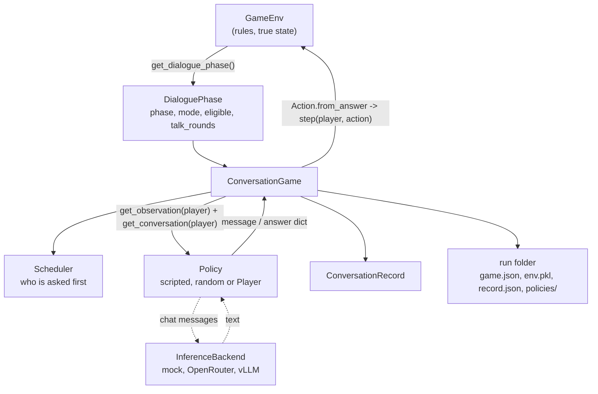
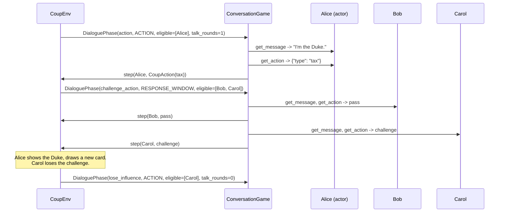
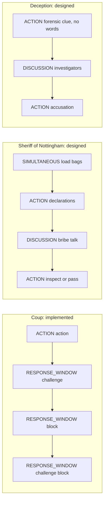

# Architecture

## The problem in one sentence

Games differ not only in their rules but in **who is allowed to act, and when**. A framework built around one `current_player` and an alternating loop cannot express a challenge window, an open discussion, or simultaneous moves.

## The main idea

Three layers, each with one job:

| Layer | Owns | Never does |
|---|---|---|
| **GameEnv** | Settings (`game_config`), true state, rules, legality, public history, `done` and `rewards` | See talk, prompts, models or policies; decide who is asked first |
| **Policy** (`ScriptedPolicy`, `Player`) | Turning what one seat may see into an answer, and optionally talk | See hidden state, call the environment, or build the game's `Action` |
| **ConversationGame** | Talk, who is asked when, building actions from answers, retries, the conversation record, saving and loading a whole game | Contain game rules |

The environment exposes the open decision point as a `DialoguePhase`. ConversationGame supports single actions, response windows, discussion, and simultaneous actions. Coup is the first implementation because it tests more than a simple alternating-turn loop.

## Design requirements

| Requirement | How it is met |
|---|---|
| Different games have different turn structures | Every decision point is an explicit `DialoguePhase` with one of four modes |
| Rules and hidden state must be trustworthy | Only the environment holds the true state and decides legality |
| Agents must not see hidden information | Policies receive `get_observation(player_id=...)` and the conversation they may see; tested |
| Talk and moves must be comparable | Talk (`get_message`) and answers (`get_action`) are separate calls and separate record entries |
| Testable without models, keys or GPUs | Seeded scripted and random policies; `MockBackend` |
| Every game can be analysed later | One JSON conversation record per game |
| Interrupted runs can resume exactly | A run folder saved between steps; settings checked on load |
| Model use is bounded and visible | A `UsageTracker` per `Player` with optional hard limits |

## Components

| Component | File | Responsible for |
|---|---|---|
| **GameEnv** | `core/env.py` | The abstract contract: `game_config`, `reset`, `get_dialogue_phase`, `get_observation`, `get_state`, `step` / `_step`, pickle `save` / `load` |
| **Action** | `core/env.py` | Abstract game action. Each game implements `from_answer` and `to_dict` |
| **DialoguePhase** | `core/env.py` | The open decision point: `phase_id`, `phase`, `mode`, `eligible`, `talk_rounds`, `description` |
| **Scheduler** | `core/scheduler.py` | Orders the eligible players of a phase |
| **ConversationGame** | `core/conversation.py` | Runs phases, talk, answers, retries and fallbacks; saves and loads a game |
| **ConversationRecord** | `core/conversation.py` | Every phase, message, action attempt and public event, in order. No private reasoning |
| **Policy** | `policies/base.py` | Abstract `get_action`; optional `get_message`; `render_observation` by game name; pickle `save` / `load` |
| **ScriptedPolicy** | `policies/scripted.py` | Seeded rule-based play (`step`). `RandomPolicy`, `FirstOptionPolicy`, `ReplayPolicy` |
| **Player** | `policies/player.py` | LLM-backed policy: prompt, generate, parse thinking and answer. Keeps its own `thoughts` history and a word-limited `thoughtpad`. Pickled without its model |
| **InferenceBackend** | `inference/` | Sends chat messages to a model, returns text and token counts |
| **CoupEnv** | `games/coup/env.py` | Coup rules on one `CoupState` (RNG included) |
| **CoupHeuristicPolicy** | `games/coup/policies.py` | Rule-based Coup play for demos and tests |

`games/__init__.py` holds three small registries keyed by game name: `ENVS` (environment class), `RENDERERS` (observation to prompt text) and `RULES` (rules text for the system prompt).

## Overall architecture



Dotted arrows exist only for `Player`. Scripted policies never touch the inference layer, which is why every test runs without a model, a network or a GPU.

## Validation levels

| Level | What is validated |
|---|---|
| Real game, mock models | Coup with `ACTION` and `RESPONSE_WINDOW`, scripted, random and `Player` policies on `MockBackend` |
| Behaviour preserved | 300 seeded games (random and heuristic, 2 to 6 players) produce the same public history, talk and winners as the engine before the redesign |
| Generic and test-supported | `DISCUSSION` and `SIMULTANEOUS` through `tests/fixtures/talk_then_vote.py` |
| Real model, earlier architecture | One full three-player Coup episode with Qwen2.5-7B-Instruct through vLLM on CARC, using the earlier `{"message", "action"}` prompt. The current `<thinking>` / `<answer>` prompt has not been run against a real model yet |

## Environment vs ConversationGame

```text
Environment answers:       WHO MAY act right now, WHAT is legal, and WHAT happens.
ConversationGame answers:  WHO DO WE ASK FIRST, when do they talk, and what if an answer is invalid?
```

Why the split matters: in a Coup challenge window, whoever is asked first and challenges closes the window for everyone else. Physical play has no fixed order, so the order is an **experimental choice**, not a rule. It lives in a `Scheduler` and can change without touching game code (`tests/test_conversation_game.py::test_scheduler_changes_who_challenges_first`).

## Mode vs phase

- **`mode`** is a framework concept. ConversationGame reads only the mode (and `talk_rounds`) to decide how to schedule.
- **`phase`** is a game concept. It names the rule being applied, for example `challenge_block`. The record and prompts show it.

| Mode | ConversationGame behaviour | Environment behaviour | Used by |
|---|---|---|---|
| `ACTION` | the one eligible player talks for `talk_rounds`, then acts | apply the action | Coup: `action` (1 talk round), `lose_influence`, `exchange` (no talk) |
| `RESPONSE_WINDOW` | eligible players, one at a time in the chosen order, each talks then acts | remove players who pass; close the window at the first challenge or block | Coup: `challenge_action`, `block_action`, `challenge_block` (1 talk round each) |
| `DISCUSSION` | `talk_rounds` rounds of talk for everyone, then each eligible player acts | decide when the phase is over from the actions | test fixture only |
| `SIMULTANEOUS` | collect **every** eligible player's answer first, then step each | keep submissions secret until everyone has acted | test fixture only |

ConversationGame notices that the environment closed a phase through `phase_id`, which increases every time a new phase opens. This is how "the first challenge closes the window" works without ConversationGame knowing anything about challenges. A player with exactly one option is a forced move: it is applied without asking the policy, and that player is not asked to talk (except in a `DISCUSSION`, where talk is the point).

## Coup: the action lifecycle



The full phase table and flowchart are in `docs/coup-rules.md`.

## How other games would fit (designed, not implemented)



The same four modes cover all three; only the phases and rules change. Details in `docs/game-format-matrix.md`.

## Data flow of one decision

1. `env.get_dialogue_phase()` returns the open phase, or `None` when the game is over. A new `phase_id` is recorded as a `phase` entry.
2. The Scheduler orders the eligible players.
3. For the next player still eligible: `env.get_observation(player_id=...)`. It includes the public `history` and the numbered menu of `options`.
4. If exactly one option exists, it is applied as a forced move. Otherwise the policy may talk for `talk_rounds` (`get_message`), then answers (`get_action`), seeing the observation and `get_conversation(player_id=...)`.
5. `env.action_class.from_answer(...)` turns the answer dict into the game's `Action`. An unreadable answer is rejected with a reason.
6. `env.step(player_id=..., action=...)` checks legality, applies the transition and returns `StepResult(accepted, error, public_events)`. An illegal action changes nothing. `n_steps` counts accepted actions only.
7. If rejected: the policy is asked again with `observation["feedback"] = error` (default 2 retries), then the first option is used as a fallback.
8. Every attempt, accepted or not, becomes an `action` entry in the record; public events become `event` entries.

## Talk vs action

```text
message: "I'm the Duke. I'll take three coins."   <- get_message, public, never validated as a move
answer:  {"type": "tax"}  or  {"option": 3}        <- get_action, turned into CoupAction(TAX) by from_answer
```

- The environment never sees talk. Talk is recorded by ConversationGame and shown to other policies through `get_conversation`.
- In Coup the claim is the action (`tax` claims the Duke), so a lie is visible by comparing the claim with the hidden cards in the full state. Saying "I have the Duke" is not a claim.
- A `Player`'s thinking never reaches ConversationGame or the record. The Player keeps it (see Inference).

## Observation vs full state

| | `get_observation(player_id=...)` | `get_state(view="full")` |
|---|---|---|
| Who uses it | policies, prompts | tests and analysis only |
| Hidden cards of other players | never (only counts) | yes |
| Court deck order | never | yes |
| Own hidden cards | yes | yes |

Tests check this two ways: the observation contains none of the god-view keys, and two games that differ only in other players' hidden cards produce identical observations and identical LLM prompts (`tests/test_coup_observation.py`, `tests/test_policies.py`). Every `get_state` view also carries `done` and `rewards`.

## The record and saving

`ConversationRecord` is one ordered list of entries, for every mode:

```json
{"index": 12, "kind": "phase | message | action | event",
 "player_id": "p2", "content": "...",
 "n_steps": 7, "phase_id": 5, "phase": "challenge_action", "mode": "response_window",
 "answer": {"option": 2}, "source": "policy | forced | fallback", "attempt": 1, "accepted": true, "error": null}
```

The last five fields appear on `action` entries only.

`ConversationGame.save(folder=...)` writes a run folder, and `run(save_folder=...)` does so after every step:

```text
<run folder>/
  game.json           game name, game_config, player ids, policy descriptions, n_steps, settings,
                      and a sha256 of every other file (written last)
  env.pkl             GameEnv.save: the whole environment, RNG included
  record.json         the conversation record
  policies/<pid>.pkl  Policy.save; a Player is saved without its model
  policies/<pid>.thoughts.json  a Player's thoughtpad and full thought history, readable (not needed to resume)
```

Saving happens only between steps, so there is never a half-finished phase to persist. On load:
- the hashes detect a save that was interrupted or edited;
- `GameEnv.load` refuses a different `game_config`, naming the mismatched keys;
- each policy must be the saved class and game;
- every `Player` needs `set_model(model=...)` before it can be asked again.

Resume rebuilds the environment from `game.json`'s `game_config`, so no setting can be lost. Pickles are only ever loaded from folders this code wrote.

## Inference

`InferenceBackend.generate(...)` accepts messages and explicit generation settings. `GenerationConfig` keeps sampling settings on the `Player`. Each `Player` has a `UsageTracker` that aggregates returned metadata and enforces optional call and token limits before later calls.

| Backend | Where the model runs | Needs |
|---|---|---|
| `MockBackend` | nowhere; canned replies | nothing |
| `OpenRouterBackend` | OpenRouter's servers | `uv sync --extra llm`, `OPENROUTER_API_KEY` |
| `VLLMBackend` | a vLLM server you started (for example on a CARC GPU node) | `uv sync --extra llm`, `VLLM_BASE_URL` |

`Player` builds its prompt from the registered rules text and renderer for its game. The model replies `<thinking>...</thinking><answer>...</answer>`. For a decision the answer is `{"option": <number>}` (a bare number or a game-shaped JSON object is also read); for talk it is the text to say, or empty to stay silent. The Player turns the answer into a dict; the game's `from_answer` turns the dict into an action and rejects anything it cannot read.

A Player keeps its thinking to itself, in two places:

| | `thoughts` | `thoughtpad` |
|---|---|---|
| What | every model call, keyed 0, 1, 2, ...: `kind` (`talk`, `action`, `summary`), `step`, `phase`, `feedback`, prompt, raw reply, thinking, answer, token usage | a running text of past thinking, one `[step N, phase] ...` line per thought |
| Size | never trimmed | at most `thoughtpad_max_words` (default 400) |
| Shown to the model | never | in every later prompt, as "Your private notes so far" |

When an appended thought pushes the thoughtpad over the limit, the Player makes one extra model call asking it to rewrite the notes, keeping only what matters for the rest of the game, in at most half the limit. The summary call is stored in `thoughts` with the pad before and after. A summary that is still too long is cut to its newest words, and if the budget is spent the newest notes are kept without a call, so the decision in progress still goes through. `ConversationGame` adds `"step"` (accepted actions so far) to every observation so thoughts can be placed in time.

## Extension points: adding a game

1. Create `games/<name>/` with an `Action` subclass (`from_answer`, `to_dict`) and a `GameEnv` subclass. Read every setting from `game_config` in `reset()`.
2. Decide the phases and give each one a mode and its `talk_rounds`.
3. Write `get_observation` so it contains only what that player may know plus `history` and `options`, and test it.
4. Make `get_state` return `done` and `rewards` in every view.
5. Register the environment, a renderer and the rules text in `games/__init__.py`. Add rule tests and a stress test with `RandomPolicy`.

No ConversationGame, policy, record or inference change is needed for a game that uses the existing four modes.

## Known limitations

- Only Coup is a real game. `DISCUSSION` and `SIMULTANEOUS` are exercised by a test fixture only.
- Messages are public. There are no private or team channels yet.
- A `Player`'s `thoughts` history is re-pickled on every save, so save time grows with long LLM games.
- The current `Player` prompt format has not been validated with a real model.
- ConversationGame is sequential and synchronous. There is no batching, no parallel episodes, and no multi-game runner yet.
- Scripted policies test the machinery, not strategy.

## Example trace

`uv run python examples/run_coup.py` (seed 0), first two turns:

```text
    Game starts with 3 players. Carol goes first.

Turn 1: Carol (2 coins)
    Carol claims the Duke and takes Tax.
  [challenge_action] response window: Alice, Bob may respond
    Alice passes.
    Bob challenges Carol's claim to be the Duke.
    Carol reveals the Duke, shuffles it back and draws a new card. Bob loses the challenge.
    Bob loses an influence (lost a challenge) and reveals the Contessa.
    Carol now has 5 coins.

Turn 2: Alice (2 coins)
    Alice claims the Captain and tries to steal from Carol.
  [challenge_action] response window: Bob, Carol may respond
    Bob passes.
    Carol passes.
  [block_action] response window: Carol may respond
    Carol claims the Ambassador to block.
  [challenge_block] response window: Alice, Bob may respond
    Alice passes.
    Bob passes.
    The block stands. Alice's steal fails.
```
